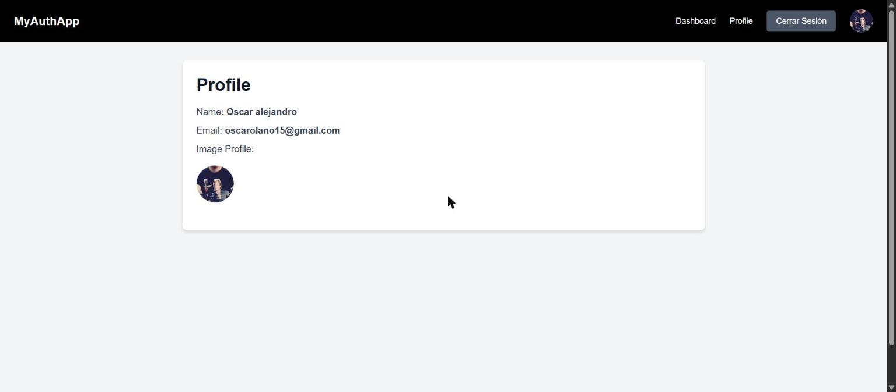
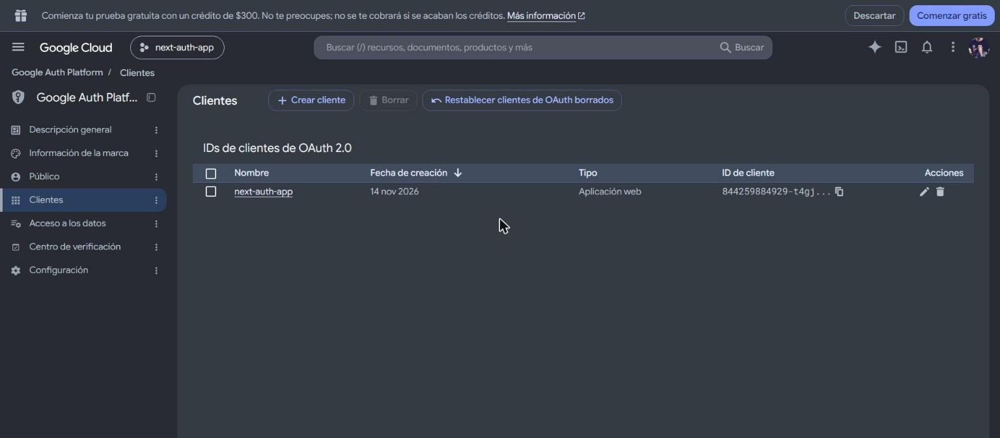

<div align="center">

# Semana 13 — Autenticación y seguridad
**Laboratorio 13 · NextAuth.js con Google OAuth**

[Volver al inicio](../README.md)

</div>

---

## Contenido
| Proyecto | Tipo | Descripción |
|---|---|---|
| [`next-auth-app`](next-auth-app) | Laboratorio | Inicio de sesión con Google (OAuth 2.0), sesión de usuario, páginas protegidas y middleware |

Stack: **Next.js 16 (App Router, Turbopack) · React 19 · TypeScript · Tailwind CSS 4 · NextAuth.js 4 · react-icons · ESLint**.

---

## Laboratorio · NextAuth.js con Google OAuth

### Cómo funciona
1. El usuario pulsa **Continue with Google** en `/signIn`.
2. NextAuth lo lleva a Google, donde elige su cuenta y da su consentimiento.
3. Google devuelve un código a `/api/auth/callback/google`; NextAuth lo cambia por los datos del usuario y crea la sesión.
4. Las páginas leen la sesión en el servidor con `getServerSession`; el middleware bloquea las rutas protegidas.

### Archivos
| Archivo | Qué hace |
|---|---|
| `src/lib/auth.ts` | Opciones de NextAuth: proveedor de Google (`GOOGLE_CLIENT_ID` y `GOOGLE_CLIENT_SECRET`) y la ruta de la página de inicio de sesión |
| `src/app/api/auth/[...nextauth]/route.ts` | Endpoint de NextAuth (`GET` y `POST`) |
| `src/components/SessionProvider.tsx` | Da la sesión a los componentes de cliente |
| `src/components/LogoutButton.tsx` | Botón **Cerrar Sesión** (`signOut`) |
| `src/app/layout.tsx` | Barra de navegación con enlaces, botón de cierre de sesión y foto de perfil |
| `src/app/page.tsx` | Redirige a `/dashboard` |
| `src/app/signIn/page.tsx` | Página de inicio de sesión con el botón de Google |
| `src/app/dashboard/page.tsx` | Dashboard con el nombre del usuario |
| `src/app/profile/page.tsx` | Perfil con nombre, correo y foto |
| `src/middleware.ts` | Protege `/dashboard` y `/profile`: sin sesión redirige a `/signIn` |
| `next.config.ts` | Permite las imágenes de perfil de Google (`lh3.googleusercontent.com`) |

### Credenciales de Google
En Google Cloud se creó el proyecto `next-auth-app`, la pantalla de consentimiento (usuarios externos, modo prueba) y un **ID de cliente OAuth de tipo aplicación web** con:

| Campo | Valor |
|---|---|
| Origen autorizado de JavaScript | `http://localhost:3000` |
| URI de redireccionamiento autorizado | `http://localhost:3000/api/auth/callback/google` |

El ID de cliente y el secreto se guardan en el archivo `.env.local`, que **no se sube al repositorio**. `.env.example` muestra las variables.

### Capturas
| Página | Captura |
|---|---|
| `/signIn`, a la que redirige el middleware cuando no hay sesión |  |
| `/dashboard` con la sesión iniciada |  |
| `/profile` con nombre, correo y foto de Google |  |
| Cliente OAuth en Google Cloud |  |

### Comprobaciones
| Prueba | Resultado |
|---|---|
| Abrir `/dashboard` sin sesión | Redirige a `/signIn?callbackUrl=%2Fdashboard` |
| Abrir `/profile` sin sesión | Redirige a `/signIn?callbackUrl=%2Fprofile` |
| Iniciar sesión con Google | Entra a `/dashboard` y muestra el nombre de la cuenta |
| **Cerrar Sesión** | Vuelve a `/signIn` y las rutas protegidas se bloquean otra vez |

---

## Cómo ejecutarlo
```bash
cd next-auth-app
npm install
cp .env.example .env.local   # completar NEXTAUTH_SECRET, GOOGLE_CLIENT_ID y GOOGLE_CLIENT_SECRET
npm run dev                  # http://localhost:3000
npm run build
```

## Notas
- En Next.js 16 un `route.ts` no puede exportar `authOptions`, por eso las opciones están en `src/lib/auth.ts` y el endpoint las importa de ahí.
- Next.js 16 avisa de que `middleware` pasó a llamarse `proxy`; el archivo `src/middleware.ts` sigue funcionando y es el que pide la guía.
- Con la app de Google en modo prueba solo pueden entrar las cuentas autorizadas del proyecto.
- `NEXTAUTH_SECRET` se genera con `openssl rand -base64 32` y nunca se sube al repositorio.
