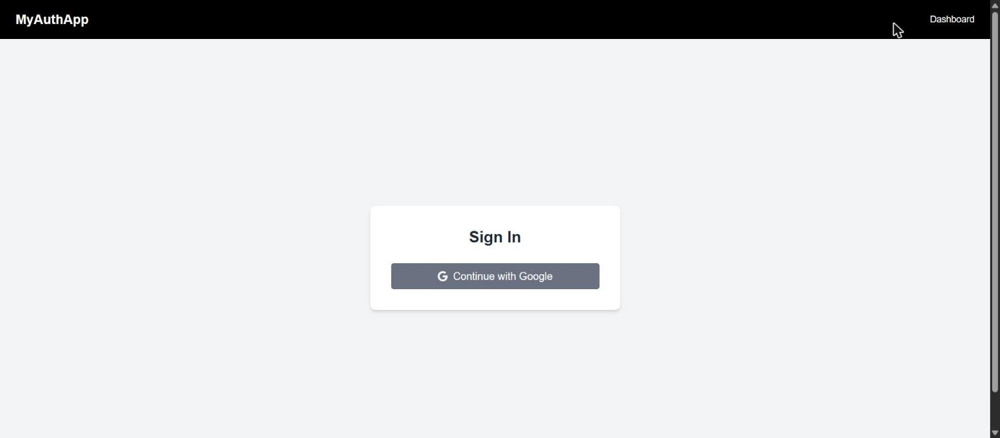
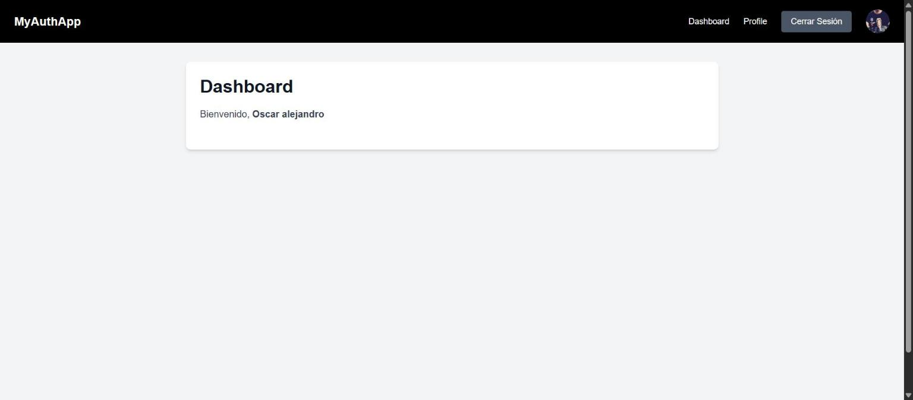
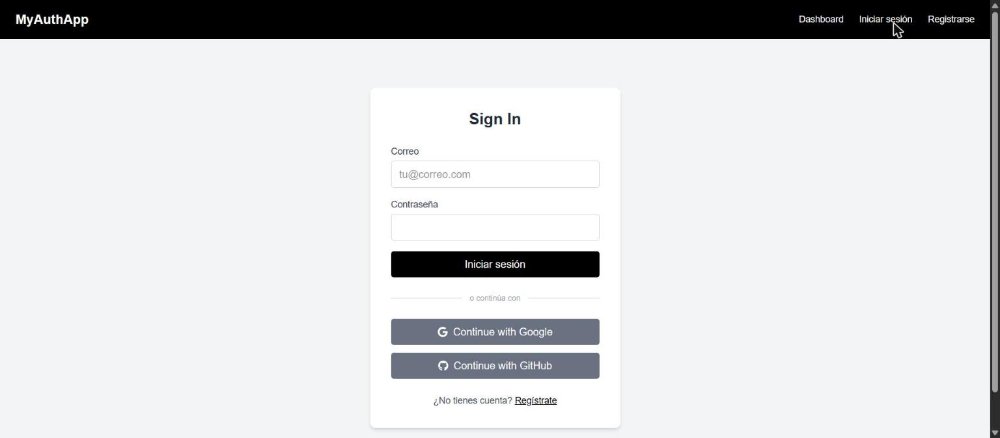
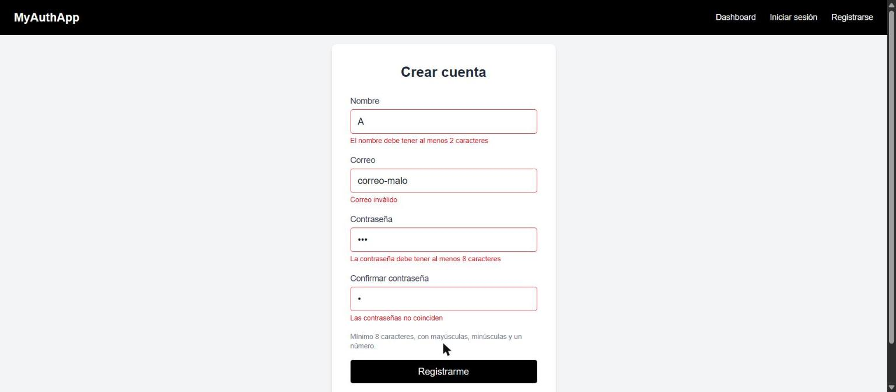
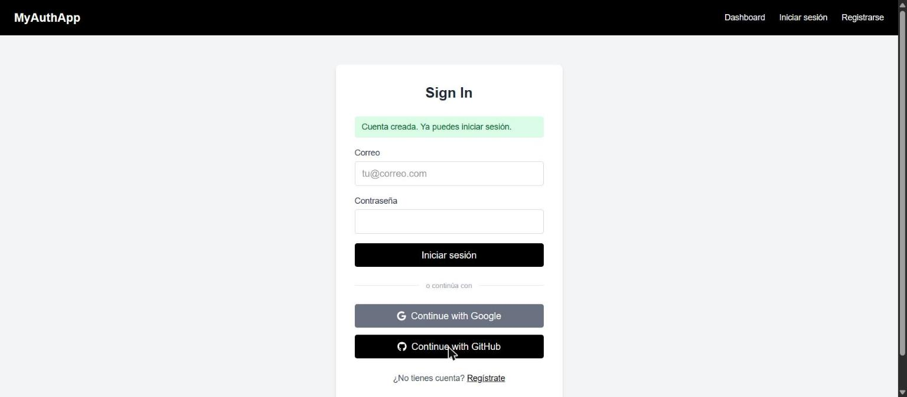
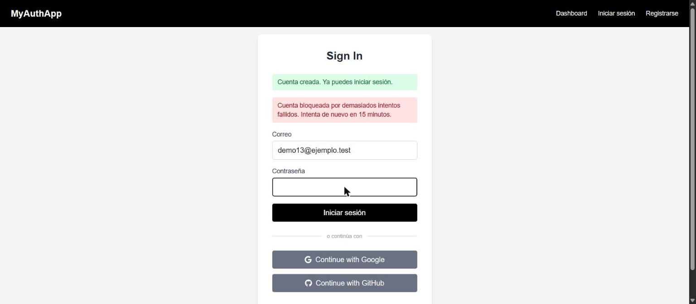
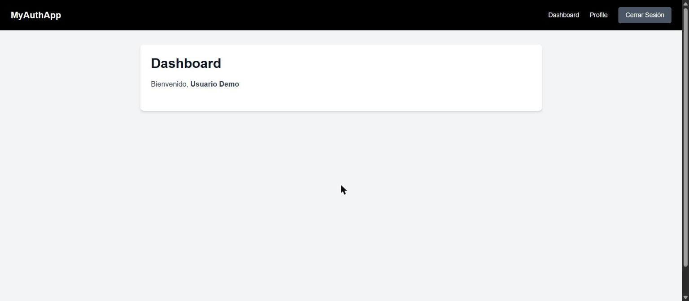
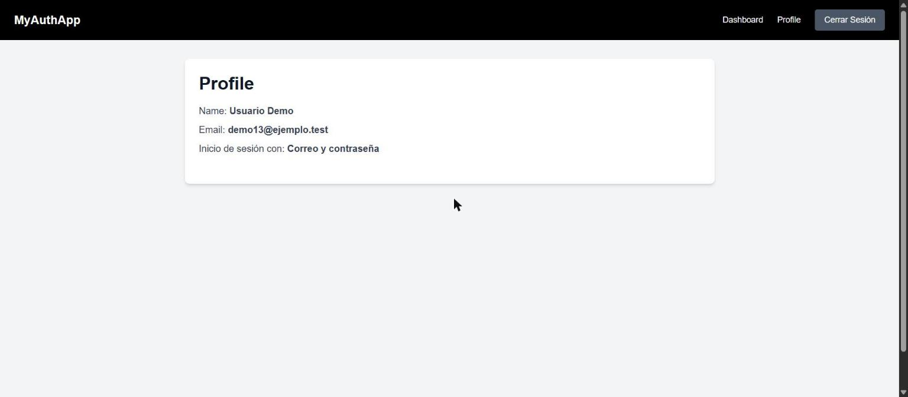
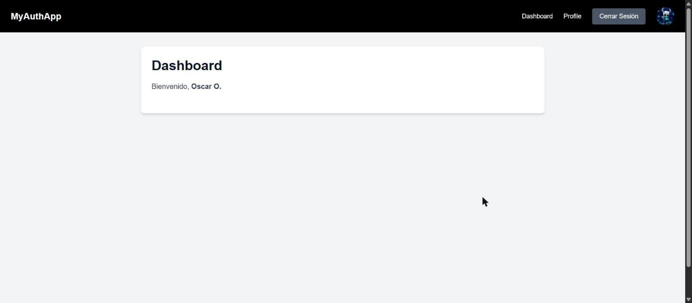
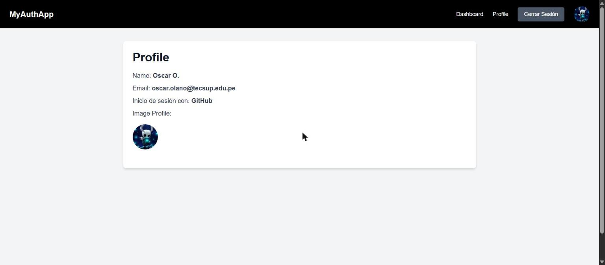

<div align="center">

# Semana 13 — Autenticación y seguridad
**Laboratorio 13 · NextAuth.js con Google OAuth · Tarea: credenciales con bcrypt, registro, bloqueo por intentos y GitHub**

[Volver al inicio](../README.md)

</div>

---

## Contenido
| Proyecto | Tipo | Descripción |
|---|---|---|
| [`next-auth-app`](next-auth-app) | Laboratorio y Tarea | Inicio de sesión con Google (laboratorio) y, sobre el mismo proyecto, inicio de sesión con correo y contraseña, registro, bloqueo por intentos fallidos y GitHub (tarea) |

**Aplicación en línea (Vercel): <https://next-auth-app-amber.vercel.app>**

Stack: **Next.js 16 (App Router, Turbopack) · React 19 · TypeScript · Tailwind CSS 4 · NextAuth.js 4 · Prisma 6 · PostgreSQL en Supabase · bcryptjs · react-icons · ESLint**.

---

## Laboratorio · NextAuth.js con Google OAuth

### Cómo funciona
1. El usuario pulsa **Continue with Google** en `/signIn`.
2. NextAuth lo lleva a Google, donde elige su cuenta y da su consentimiento.
3. Google devuelve un código a `/api/auth/callback/google`; NextAuth lo cambia por los datos del usuario y crea la sesión.
4. Las páginas leen la sesión en el servidor con `getServerSession`; el middleware bloquea las rutas protegidas.

### Archivos del laboratorio
| Archivo | Qué hace |
|---|---|
| `src/lib/auth.ts` | Opciones de NextAuth: proveedor de Google y ruta de la página de inicio de sesión |
| `src/app/api/auth/[...nextauth]/route.ts` | Endpoint de NextAuth (`GET` y `POST`) |
| `src/components/SessionProvider.tsx` | Da la sesión a los componentes de cliente |
| `src/components/LogoutButton.tsx` | Botón **Cerrar Sesión** (`signOut`) |
| `src/app/layout.tsx` | Barra de navegación con enlaces, botón de cierre de sesión y foto de perfil |
| `src/app/page.tsx` | Redirige a `/dashboard` |
| `src/app/signIn/page.tsx` | Página de inicio de sesión |
| `src/app/dashboard/page.tsx` | Dashboard con el nombre del usuario |
| `src/app/profile/page.tsx` | Perfil con nombre, correo y foto |
| `src/middleware.ts` | Protege `/dashboard` y `/profile`: sin sesión redirige a `/signIn` |
| `next.config.ts` | Permite las imágenes de perfil de Google |

### Credenciales de Google
En Google Cloud se creó el proyecto `next-auth-app`, la pantalla de consentimiento (usuarios externos, modo prueba) y un **ID de cliente OAuth de tipo aplicación web**:

| Campo | Valor |
|---|---|
| Orígenes autorizados de JavaScript | `http://localhost:3000` y `https://next-auth-app-amber.vercel.app` |
| URIs de redireccionamiento autorizados | `http://localhost:3000/api/auth/callback/google` y `https://next-auth-app-amber.vercel.app/api/auth/callback/google` |

### Capturas del laboratorio
| Página | Captura |
|---|---|
| `/signIn`, a la que redirige el middleware cuando no hay sesión |  |
| `/dashboard` con la sesión iniciada con Google |  |
| `/profile` con nombre, correo y foto de Google |  |
| Cliente OAuth en Google Cloud |  |

---

## Tarea · Credenciales, registro, bloqueo y GitHub

### Requisitos
| Requisito | Cómo se cumple |
|---|---|
| Inicio de sesión con credenciales (`CredentialsProvider`) | `src/lib/auth.ts`: busca al usuario por correo y compara la contraseña con bcrypt. Formulario en `src/components/SignInForm.tsx` |
| Formulario de registro | `src/app/register/page.tsx` y `src/app/api/register/route.ts`. Pide nombre, correo, contraseña y confirmación |
| Bloquear el inicio de sesión tras varios intentos | Tras **5 intentos fallidos** la cuenta se bloquea **15 minutos** (`src/lib/security.ts`). El contador y la hora de desbloqueo se guardan en la base de datos; un inicio correcto los reinicia |
| Cifrar las contraseñas con bcrypt | Se guarda solo el hash (`bcryptjs`, 12 rondas). La contraseña nunca se guarda ni se devuelve en texto plano |
| Autenticación con GitHub (`GitHubProvider`) | Botón **Continue with GitHub** en `/signIn`; OAuth App creada en GitHub con las URLs de retorno de local y de producción |

### Seguridad
- **Validación en el cliente y en el servidor.** Las mismas reglas (`src/lib/validation.ts`) se aplican en los formularios y otra vez en las rutas del servidor: nombre de 2 a 60 caracteres, correo válido y contraseña de 8 a 72 caracteres con mayúsculas, minúsculas y un número.
- **Sin pistas para atacantes.** Un correo que no existe responde igual que una contraseña incorrecta, y se hace la misma comparación con bcrypt para que tarde lo mismo.
- **Mensajes claros para el usuario.** Muestra cuántos intentos quedan y, al bloquear, cuántos minutos faltan.
- **Sesión con JWT** de 8 horas; el perfil indica con qué método se entró.
- **Secretos fuera del repositorio.** `.env.local` está ignorado por Git y `.env.example` solo muestra los nombres de las variables.

### Base de datos
Los usuarios con correo y contraseña se guardan en **Supabase** (PostgreSQL) con Prisma, en un esquema propio llamado `auth13`, para no mezclarlos con otras tablas. Modelo `User`: `id`, `name`, `email` (único), `passwordHash`, `failedAttempts`, `lockedUntil`, `createdAt` y `updatedAt` (`prisma/schema.prisma`).

### Archivos nuevos de la tarea
| Archivo | Qué hace |
|---|---|
| `src/lib/auth.ts` | Agrega los proveedores de credenciales y GitHub, el bloqueo por intentos y el proveedor en la sesión |
| `src/lib/security.ts` | Límite de intentos, minutos de bloqueo y rondas de bcrypt |
| `src/lib/validation.ts` | Validación compartida del registro y del inicio de sesión |
| `src/lib/prisma.ts` | Cliente de Prisma |
| `src/app/api/register/route.ts` | Registro de usuarios (`201`, `400`, `409`) |
| `src/app/register/page.tsx` | Formulario de registro |
| `src/components/SignInForm.tsx` | Formulario de inicio de sesión y botones de Google y GitHub |
| `src/app/profile/page.tsx` | Muestra con qué método se inició sesión |
| `prisma/schema.prisma` | Tabla de usuarios |

### Pruebas automáticas
Se probó el flujo completo contra la aplicación en marcha (20 comprobaciones, todas correctas):

| Prueba | Resultado |
|---|---|
| Registro con datos inválidos, contraseña sin número o confirmación distinta | `400` con el detalle por campo |
| Registro correcto | `201`, sin el hash en la respuesta |
| Correo repetido, aunque cambien las mayúsculas | `409` |
| Contraseña en la base de datos | Hash bcrypt (`$2…`), distinto de la contraseña |
| Correo que no existe | Mismo error que una contraseña incorrecta |
| Intentos fallidos 1.º a 4.º | `INVALID` con 4, 3, 2 y 1 intentos restantes |
| 5.º intento fallido | Cuenta bloqueada 15 minutos |
| Contraseña correcta con la cuenta bloqueada | Sigue bloqueada |
| Pasado el bloqueo, contraseña correcta | Inicia sesión y reinicia el contador |
| `/dashboard` sin sesión | Redirige a `/signIn` |

### Capturas de la tarea
| Paso | Captura |
|---|---|
| `/signIn` con correo y contraseña, Google y GitHub |  |
| Registro con datos inválidos: errores por campo |  |
| Cuenta creada: aviso en `/signIn` |  |
| Contraseña incorrecta: quedan 4 intentos |  |
| 5.º intento fallido: cuenta bloqueada 15 minutos |  |
| Dashboard con correo y contraseña |  |
| Perfil con correo y contraseña |  |
| Dashboard con GitHub |  |
| Perfil con GitHub |  |

---

## Cómo ejecutarlo
```bash
cd next-auth-app
npm install
cp .env.example .env.local   # completar las variables (ver abajo)
npm run db:push              # crea la tabla de usuarios en el esquema auth13
npm run dev                  # http://localhost:3000
npm run build
```

| Variable | Para qué sirve |
|---|---|
| `NEXTAUTH_URL` | Dirección de la aplicación (`http://localhost:3000` en local) |
| `NEXTAUTH_SECRET` | Firma de las sesiones; se genera con `openssl rand -base64 32` |
| `GOOGLE_CLIENT_ID` y `GOOGLE_CLIENT_SECRET` | Credenciales OAuth de Google Cloud |
| `GITHUB_ID` y `GITHUB_SECRET` | Credenciales de la OAuth App de GitHub |
| `DATABASE_URL` | Conexión a Supabase con `?schema=auth13&connection_limit=1` |

## Notas
- En Next.js 16 un `route.ts` no puede exportar `authOptions`, por eso las opciones están en `src/lib/auth.ts` y el endpoint las importa de ahí.
- Next.js 16 avisa de que `middleware` pasó a llamarse `proxy`; el archivo `src/middleware.ts` sigue funcionando y es el que pide la guía.
- Con la app de Google en modo prueba solo pueden entrar las cuentas autorizadas del proyecto.
- GitHub permite varias URLs de retorno en una misma OAuth App, por eso una sola sirve para local y producción.
- Se usa `bcryptjs`, que implementa el mismo algoritmo bcrypt, porque no necesita compilar y funciona igual en Windows y en Vercel.
