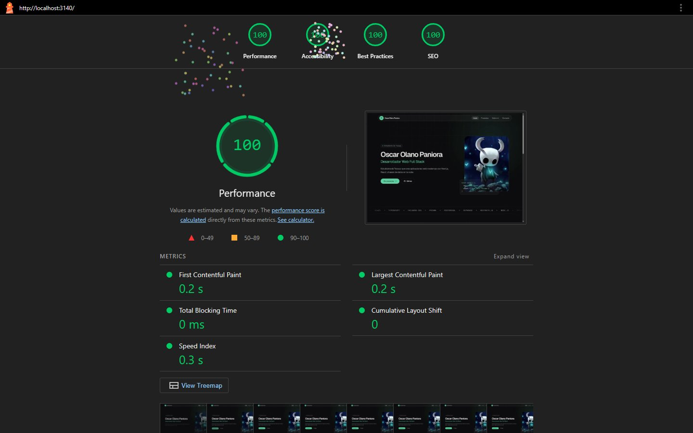
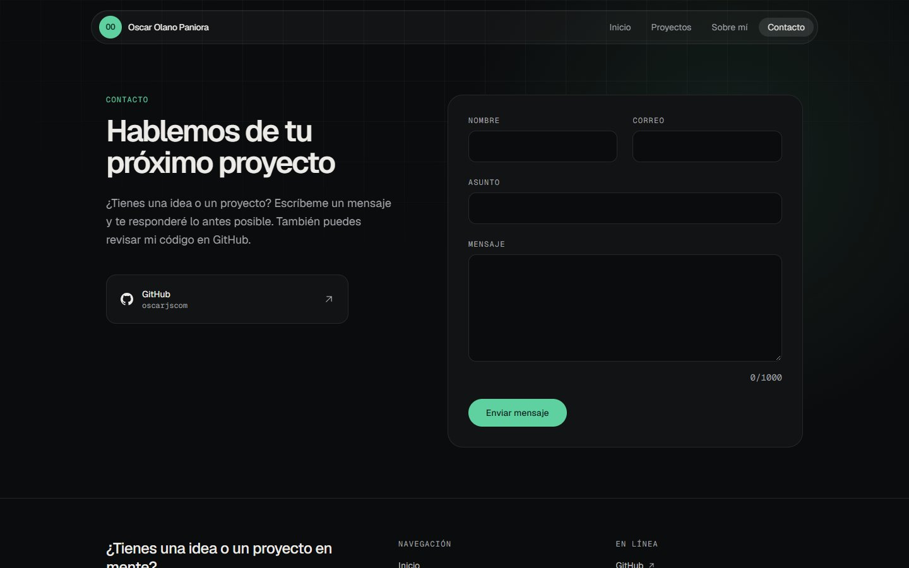
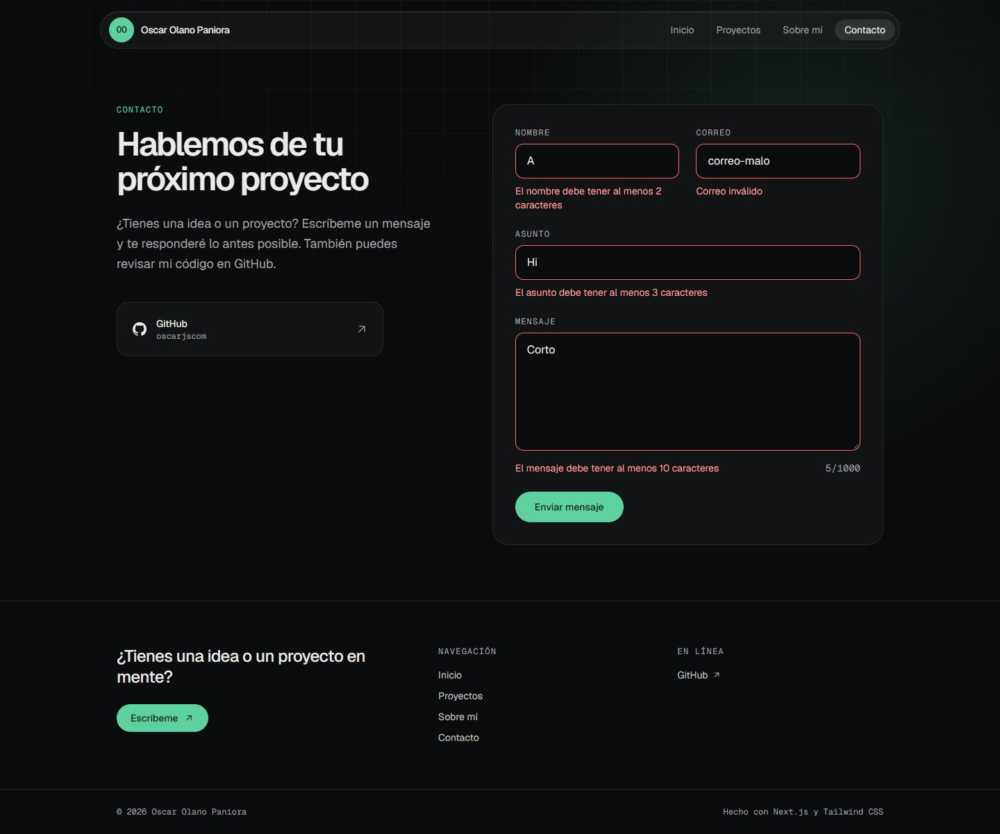
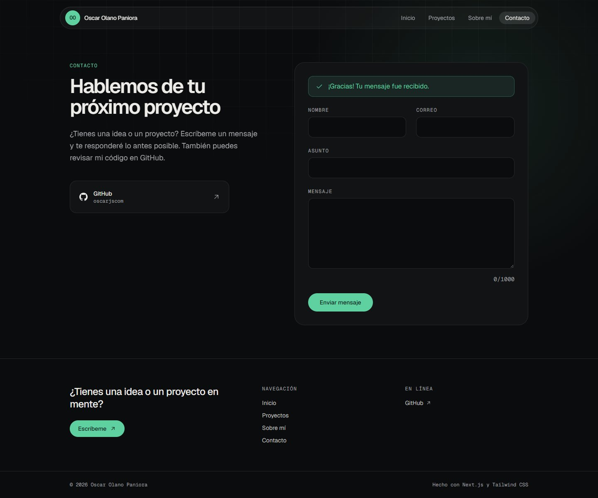
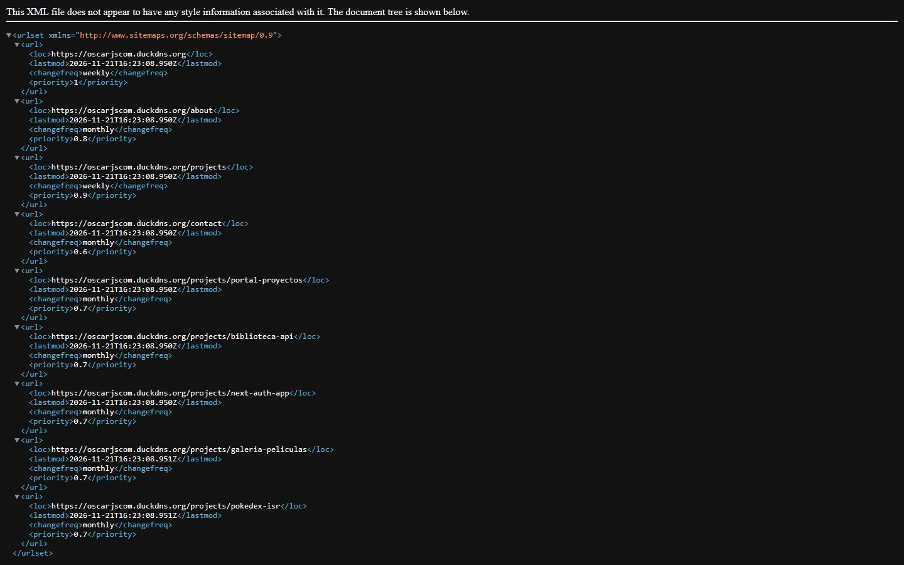
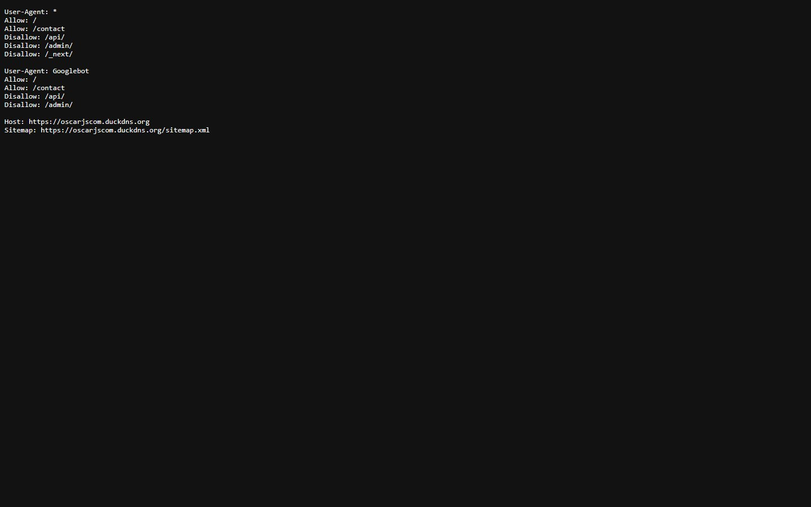
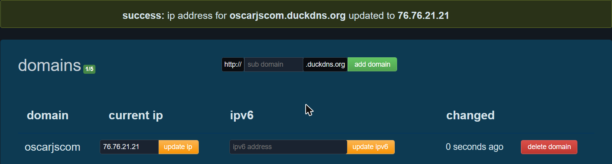
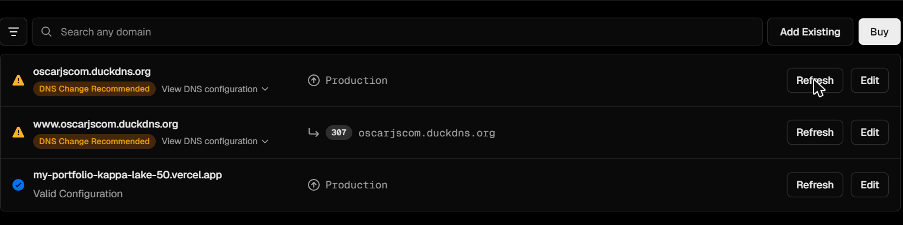
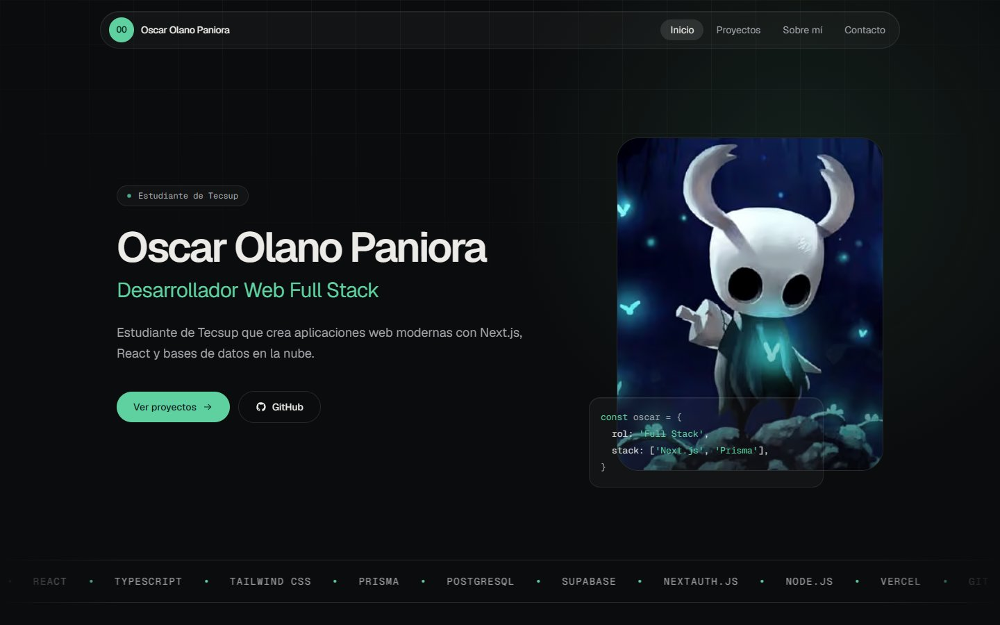
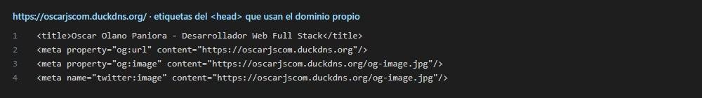

<div align="center">

# Semana 14 — Optimización y SEO
**Laboratorio 14 · Portafolio personal con SEO optimizado**

[Volver al inicio](../README.md)

</div>

---

## Contenido
| Proyecto | Tipo | Descripción |
|---|---|---|
| [`my-portfolio`](my-portfolio) | Laboratorio y Tarea | Portafolio personal con meta tags dinámicos, Open Graph, imágenes optimizadas, `sitemap.xml` y `robots.txt`; en la tarea, página de contacto, sitemap y robots actualizados y dominio propio |

Stack: **Next.js 16 (App Router, Turbopack) · React 19 · TypeScript · Tailwind CSS 4 · ESLint**.

---

## Laboratorio · Portafolio con SEO optimizado

El portafolio muestra proyectos reales de este curso (Portal, Biblioteca, autenticación con NextAuth, galería de películas y Pokédex), con su demo y su código en GitHub.

**Diseño propio.** Tema oscuro de base grafito con un solo acento verde menta, tipografía Geist y Geist Mono (paquete `geist`, sin depender de Google Fonts en el build), encabezado flotante con enlace activo, inicio asimétrico con cinta de tecnologías y cifras reales del recorrido, grilla de proyectos asimétrica (7/5 y pieza ancha), detalle con "siguiente proyecto" y página 404 propia. Las animaciones usan solo `transform` y `opacity` y se desactivan con `prefers-reduced-motion`.

### Qué se implementó
| Parte | Qué se hizo | Archivos |
|---|---|---|
| **1. Meta tags dinámicos** | Título con plantilla (`%s \| Nombre`), descripción, palabras clave, autor, `robots`, Open Graph y Twitter Card en el layout; cada página y cada proyecto define su propio título, descripción e imagen con `generateMetadata` | `src/app/layout.tsx`, `src/app/projects/page.tsx`, `src/app/projects/[slug]/page.tsx` |
| **2. Componentes compartidos** | Encabezado con la navegación (enlace activo) y pie de página | `src/components/Header.tsx`, `NavLinks.tsx`, `Footer.tsx`, `TechMarquee.tsx` |
| **3. Imágenes optimizadas** | `next/image` con formatos AVIF y WebP, tamaños por dispositivo, dominios externos autorizados, `sizes` y carga diferida (`loading="lazy"`); `priority` en la imagen principal | `next.config.ts`, `src/components/ProjectCard.tsx`, `src/app/about/page.tsx` |
| **4. Sitemap dinámico** | Genera `sitemap.xml` con las páginas fijas y una entrada por cada proyecto | `src/app/sitemap.ts` |
| **5. robots.txt** | Permite indexar el sitio, bloquea `/api/`, `/admin/` y `/_next/`, y apunta al sitemap | `src/app/robots.ts` |
| **6. Verificación** | Etiquetas `<meta>` del `<head>` y auditoría de Lighthouse en escritorio y móvil | Capturas |

Además se generaron las imágenes para compartir en redes (`public/og-image.jpg` y `public/og-projects.jpg`, de 1200 × 630) que el layout referencia, y las rutas de los proyectos se generan estáticas con `generateStaticParams`.

### Rutas
| Ruta | Contenido |
|---|---|
| `/` | Presentación y proyectos destacados |
| `/projects` | Todos los proyectos |
| `/projects/[slug]` | Detalle de un proyecto, por ejemplo `/projects/portal-proyectos` |
| `/about` | Sobre mí y habilidades técnicas |
| `/sitemap.xml` | Mapa del sitio generado |
| `/robots.txt` | Reglas para los buscadores |

### Resultados de Lighthouse
Auditoría de la versión de producción (`npm run build` y `npm start`), con el objetivo de la guía de más de 90 en todas las categorías:

| Modo | Rendimiento | Accesibilidad | Mejores prácticas | SEO |
|---|---|---|---|---|
| Escritorio | 100 | 100 | 100 | 100 |
| Móvil | 93 | 100 | 100 | 100 |

### Capturas
| Página | Captura |
|---|---|
| Inicio (`/`) |  |
| Proyectos (`/projects`) |  |
| Detalle de un proyecto (`/projects/portal-proyectos`) |  |
| Sobre mí (`/about`) |  |
| `sitemap.xml` |  |
| `robots.txt` |  |
| Etiquetas `<meta>` y Open Graph del `<head>` |  |
| Lighthouse en escritorio |  |
| Lighthouse en móvil |  |

---

## Tarea · Contacto, sitemap, robots y dominio propio

**Sitio en producción:** https://oscarjscom.duckdns.org  
(alias de Vercel: https://my-portfolio-kappa-lake-50.vercel.app)

### Qué se hizo
| Punto de la tarea | Qué se hizo | Archivos |
|---|---|---|
| **Página de contacto** | Formulario con nombre, correo, asunto y mensaje. Valida en el navegador y el servidor vuelve a validar; muestra errores por campo y un mensaje de confirmación | `src/app/contact/page.tsx`, `src/components/ContactForm.tsx`, `src/lib/validation.ts`, `src/app/api/contact/route.ts` |
| **Actualizar `sitemap.xml`** | Se agregó `/contact` junto a las páginas fijas y a los proyectos | `src/app/sitemap.ts` |
| **Actualizar `robots.txt`** | Permite `/` y `/contact`, bloquea `/api/`, `/admin/` y `/_next/`, e indica el `Sitemap` y el `Host` del dominio | `src/app/robots.ts` |
| **Desplegar en Vercel** | Despliegue de producción del proyecto `my-portfolio` | `.vercelignore` |
| **Dominio gratuito** | Subdominio `oscarjscom.duckdns.org` creado en DuckDNS (Freenom ya no existe), apuntado a Vercel con un registro A y agregado en Settings → Domains; `www` redirige al dominio principal. Vercel emite el certificado HTTPS | Capturas 15 a 18 |

La dirección del sitio sale de un solo lugar, `siteUrl` en `src/lib/data.ts`, y de ahí se alimentan los meta tags, el sitemap y el robots, así que al cambiar de dominio no hay que tocar nada más.

El formulario valida y registra el mensaje en el servidor, pero no envía correos: no se publica ningún correo personal en el sitio.

### Capturas de la tarea
| Qué muestra | Captura |
|---|---|
| Página de contacto (`/contact`) |  |
| Validación del formulario con datos inválidos |  |
| Mensaje enviado correctamente |  |
| `sitemap.xml` actualizado (con `/contact`) en el dominio propio |  |
| `robots.txt` actualizado en el dominio propio |  |
| DuckDNS: `oscarjscom.duckdns.org` apuntando a Vercel |  |
| Vercel: dominios asociados al proyecto |  |
| Portafolio en `oscarjscom.duckdns.org` |  |
| Etiquetas del `<head>` con el dominio propio |  |

---

## Cómo ejecutarlo
```bash
cd my-portfolio
npm install
npm run dev      # http://localhost:3000
npm run build
npm start
```

## Notas
- La dirección pública del sitio (`https://oscarjscom.duckdns.org`) está en `siteUrl` (`src/lib/data.ts`) y se puede cambiar con la variable `NEXT_PUBLIC_SITE_URL`. De ahí salen la URL base de los meta tags, el sitemap y el `robots.txt`.
- Las imágenes de los proyectos son capturas de las aplicaciones de las semanas anteriores, guardadas en `public/projects`. La foto de perfil se carga desde GitHub, un dominio externo autorizado en `next.config.ts`.
- No se publican datos de contacto personales en el sitio.
- Las capturas y la auditoría se tomaron con la versión de producción en el puerto 3140, porque el 3000 estaba ocupado por otra aplicación.
- Vercel recomienda cambiar el registro A del dominio a `216.198.79.1`; esa IP no respondió desde mi red, así que el dominio se dejó con `76.76.21.21`, que sí funciona.
